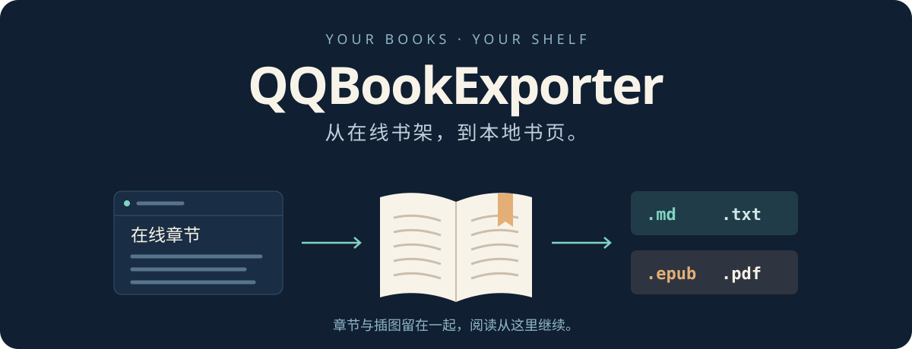

<p align="center">
  
</p>

<p align="center">
  <strong>把 QQ 阅读与轻小说网中可访问的书籍，整理成自己的本地书架。</strong><br>
  按章导出正文与插图，合并整本内容，再按需生成 EPUB 或 PDF。
</p>

<p align="center">
  <a href="./package.json"></a>
  <a href="./exporter.js"></a>
  <a href="#导出结果"></a>
  <a href="#打包为-epub-或-pdf"></a>
  <a href="./LICENSE"></a>
</p>

## 导出结果

默认导出 Markdown，每章一个文件，图片保存在本地，并额外生成合并版。下面是目录结构示意；EPUB、PDF 需要运行打包工具后生成。

```text
output/<书籍ID>-<书名>/
├── 001-封面.md
├── 002-版权信息.md
├── 003-第一章.md
├── images/
│   └── <章节ID>/
│       └── illustration.jpg
├── <书名>.md               # 自动生成的合并版
├── <书名>.epub             # 可选：EPUB 打包工具生成
├── _print.html             # EPUB 打包时同时生成
└── <书名>.pdf              # 可选：PDF 打包工具生成
```

- **保留阅读结构**：Markdown 保留标题、强调和插图，图片使用相对路径引用。
- **按章与整本并存**：章节按序号补零命名；合并版调整标题层级，便于连续阅读。
- **按需导出**：支持 TXT、忽略指定章节、调整请求间隔和自定义目录。
- **两种站点入口**：新版站点默认通过 HTTP 导出；旧站保留浏览器导出模式。

## 快速开始

需要本机安装 Node.js 和 pnpm（也可使用 npm）。扫码登录、旧站导出与 PDF 打印默认使用 Windows 上的 Microsoft Edge；EPUB 打包另需 Python 3。

```bash
git clone https://github.com/HP-Patience/QQBookExporter.git
cd QQBookExporter
pnpm install --frozen-lockfile

# 免费章节可直接导出，书籍 ID 和详情页链接均可
node exporter.js https://book.novel.qq.com/detail/1046034492
```

使用 npm 时，将安装命令替换为 `npm install`。这是命令行工具，直接运行脚本即可。

### 登录后导出

```bash
# 打开 Edge 扫码登录，检测成功后自动保存 Cookie 并继续导出
node exporter.js 1046034492 --login
```

也可以先单独登录，再运行导出命令：

```bash
node login.js
node exporter.js 1046034492
```

新版登录流程会自动检测登录状态，无需手动关闭标签页。Cookie 保存在项目根目录的 `.cookie` 文件中，下次导出时会自动读取。

> [!IMPORTANT]
> 登录后仍受账号阅读权限限制。免费章节可直接导出；付费章节需要账号具有对应阅读权限。接口未授权或正文为空时，程序会跳过并汇总原因。

### 常用命令

```bash
# 导出纯文本
node exporter.js 1046034492 -m txt

# 忽略指定章节序号 / ID，或一个连续区间
node exporter.js 1046034492 -x 1,2,3
node exporter.js 1046034492 -x 1-9

# 自定义目录和章节请求间隔（毫秒）
node exporter.js 1046034492 -o "output/my-book" --delay 800

# 只保存分章文件
node exporter.js 1046034492 --no-merge

# 使用旧站的浏览器导出模式
node exporter.js <书籍ID> --source qq
```

### 命令参数

| 参数 | 用途 | 默认值 |
| --- | --- | --- |
| `<bookId>` | 书籍 ID 或详情页链接，必填 | — |
| `-m, --mode <mode>` | `markdown` 或 `txt` | `markdown` |
| `-o, --output <dir>` | 自定义输出目录 | `output/<bid>-<书名>` |
| `-x, --ignore <chapters>` | 忽略章节序号或 ID（新版），支持 `1,2,3`、`1-9` 或 `3` | 无 |
| `-s, --source <source>` | 新版站点 `novel` 或旧站 `qq` | `novel` |
| `-l, --login` | 扫码登录后继续导出（新版站点） | 关闭 |
| `-c, --cookie <cookie>` | 手动传入登录 Cookie（新版站点） | 自动读取环境变量或文件 |
| `--no-merge` | 禁用整本合并（新版站点） | 默认合并 |
| `--delay <ms>` | 章节请求间隔（新版站点，毫秒） | `400` |
| `--edge <path>` | 登录或旧站模式使用的浏览器可执行文件 | Windows Edge 默认路径 |
| `-h, --help` | 查看完整命令帮助 | — |

## 打包为 EPUB 或 PDF

打包工具读取已经导出的 **Markdown 目录**，不会重新下载书籍。

```bash
# 生成 EPUB，并同时生成 PDF 打印用的 _print.html
python tools/build_epub.py "output/<书籍ID>-<书名>" --title "书名" --author "作者"

# 将上一步的 HTML 打印为 PDF（需要 Edge）
node tools/build_pdf.js "output/<书籍ID>-<书名>/_print.html" "output/<书籍ID>-<书名>/书名.pdf"
```

EPUB 工具使用 Python 标准库，生成目录并包含本地插图。默认将“第 X 章 / 第 X 节”转换成 `1` / `1.1` 式编号；加上 `--no-number` 可保留原始中文序号。PDF 使用 A4 排版，保留背景并按章节分页。

## 站点与登录配置

| 入口 | 工作方式 | 使用说明 |
| --- | --- | --- |
| `book.novel.qq.com` | HTTP 接口，默认 `--source novel` | 免费章节无需浏览器；登录用于账号有权阅读的章节 |
| `book.qq.com` | Edge 浏览器，指定 `--source qq` | 手动登录后关闭最初的书籍标签页，触发导出 |

两个站点的书籍可用性可能不同。如果旧站找不到书籍，可尝试新版站点。

<details>
<summary><strong>手动提供 Cookie</strong></summary>

优先使用 `--login`。需要手动配置时，在已登录浏览器的开发者工具中，找到阅读请求的 `Cookie` 请求头，并通过以下任一方式传入：

```powershell
# Windows PowerShell：仅对当前终端设置环境变量
$env:QQREAD_COOKIE = "你的 Cookie 字符串"
node exporter.js 1046034492
```

也可把 Cookie 字符串写入根目录的 `.cookie` 文件，或使用 `-c "你的 Cookie 字符串"`。读取优先级为：命令行 `-c` → `QQREAD_COOKIE` → `.cookie`。

</details>

<details>
<summary><strong>代理与浏览器路径</strong></summary>

新版站点请求默认直连，不读取系统 `HTTP_PROXY`。需要指定代理时：

```powershell
$env:QQREAD_PROXY = "http://127.0.0.1:7890"
node exporter.js 1046034492
```

扫码登录或旧站模式找不到 Edge 时，可指定浏览器可执行文件：

```powershell
node exporter.js 1046034492 --login --edge "C:\Program Files (x86)\Microsoft\Edge\Application\msedge.exe"
```

PDF 工具使用代码中的默认 Edge 路径，目前不提供命令行路径参数。

</details>

> [!WARNING]
> `.cookie` 是账号凭证。项目已忽略该文件和 `output/` 导出目录，请勿把 Cookie、登录信息或书籍正文提交到仓库。

## 来源与许可

本项目基于 [aquamarine5/QQBookExporter](https://github.com/aquamarine5/QQBookExporter) 继续开发，保留原作者署名，使用 [GNU LGPL v2.1](./LICENSE) 许可证。

本项目与 QQ 阅读及轻小说网无隶属关系。请仅处理你有权访问和保存的内容，遵守相关站点规则及版权要求。
