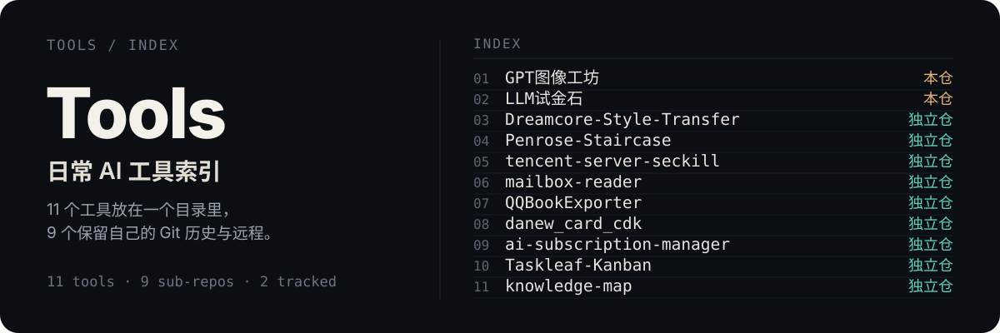
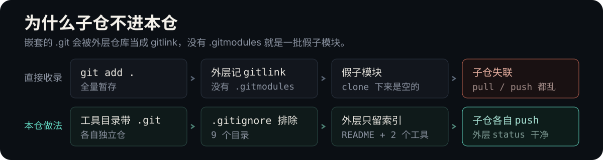

<p align="center">
  
</p>

<p align="center">
  <strong>把日常在用的 11 个小工具收进一个目录，每个工具保留自己的 Git 历史与远程仓库。</strong><br>
  外层仓库只跟踪索引与两个可直接运行的工具，其余九个以独立仓库存在，各自 pull 与 push。
</p>

<p align="center">
  <a href="https://github.com/wilsoncslearn/AI_Tools"></a>
  <a href="https://github.com/wilsoncslearn/AI_Tools/commits/main"></a>
  <a href="https://github.com/wilsoncslearn/AI_Tools"></a>
  <a href="#工具清单"></a>
  <a href="#工具清单"></a>
</p>

## 这是什么

日常在用的小工具合集。11 个工具的形态各不相同——静态页、Python 脚本、Node 服务、Go 后端、TypeScript 应用——没有可以共用的代码层，所以不合并历史，只归拢位置。

放在一起的理由只有一个：**要找的时候知道去哪儿找**。

> **公开范围**：本仓只跟踪 `GPT图像工坊` 与 `LLM试金石`。其余 9 个在本地以独立仓库存在，由 `.gitignore` 排除，不随本仓分发。

## 工具清单

带链接的工具随本仓提交，克隆后即可运行；其余为独立仓，需在本地另行取用。

### 图像与模型

| 工具 | 做什么 |
|---|---|
| [`GPT图像工坊`](./GPT图像工坊/) | 输入提示词生成图片，支持参考图编辑与本地标注 · FastAPI |
| [`LLM试金石`](./LLM试金石/) | 批量验证 OpenAI 兼容接口的模型连通性与耗时 · 静态页 |
| `Dreamcore-Style-Transfer` | 用 Pillow 做 10 种「核」风格的像素级处理 · Python |
| `Penrose-Staircase` | 生成第 n 阶彭罗斯不可能阶梯 · Python |

### 采集与自动化

| 工具 | 做什么 |
|---|---|
| `tencent-server-seckill` | 腾讯云服务器抢购的本地控制台与命令行 · Python + Playwright |
| `mailbox-reader` | 批量导入邮箱，按需读取收件箱 · Python + Graph API |
| `QQBookExporter` | 导出在线章节为 Markdown / TXT，再打包 EPUB / PDF · Node.js |

### 应用与看板

| 工具 | 做什么 |
|---|---|
| `Taskleaf-Kanban` | 四列任务看板，JSON 文件持久化 · 原生 JS + Vite + Express |
| `ai-subscription-manager` | AI 订阅客户、续费与利润记录，到期邮件提醒 · React + FastAPI + SQLite |
| `knowledge-map` | Agent 整理、浏览器只读回看的个人知识地图 · TypeScript + Vite |
| `danew_card_cdk` | CDK 卡密兑换与自动开通 · Go + Vue |

## 为什么不是一个仓

<p align="center">
  
</p>

嵌套的 `.git` 会被外层仓库当作 gitlink，`git add .` 会生成一批没有 `.gitmodules` 的假子模块。所以本仓的 `.gitignore` 显式排除了这些目录：

```gitignore
/Dreamcore-Style-Transfer/
/tencent-server-seckill/
/Taskleaf-Kanban/
/QQBookExporter/
/Penrose-Staircase/
/mailbox-reader/
/knowledge-map/
/ai-subscription-manager/
/danew_card_cdk/
```

结果：外层 `git status` 保持干净，子仓仍可各自 `git pull` 与 `git push`。

## 怎么用

```bash
git clone https://github.com/wilsoncslearn/AI_Tools.git
cd AI_Tools
```

两个随仓工具各自独立运行：

```bash
cd LLM试金石
python server.py
```

```bash
cd GPT图像工坊
python -m venv .venv
.venv\Scripts\activate
pip install -r requirements.txt
python app.py
```

其余工具需要先在本地取到对应目录，再按各自 `README.md` 安装依赖。

## 新增一个工具

1. 在根目录建一个独立目录，内含自己的 `README.md`。
2. 若该目录自带 `.git`，把路径写进 `.gitignore`，保持外层 `git status` 干净。
3. 在本 README 的工具清单里补一行，写明用途与技术栈。
4. 不提交 `.env`、API Key、Token、Cookie 与本地数据库。

## 说明

- 9 个独立仓不在本仓跟踪范围，`clone` 后只有 2 个工具可以直接运行。
- 这些子仓的远程仓库已不再公开，`git fetch` 会报 `Repository not found`，属预期。
- 运行环境要求以各工具自己的 `README.md` 为准，例如 `knowledge-map` 与 `Taskleaf-Kanban` 需要 Node.js 24。
