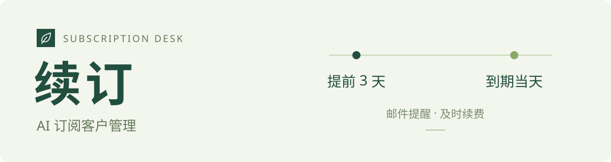
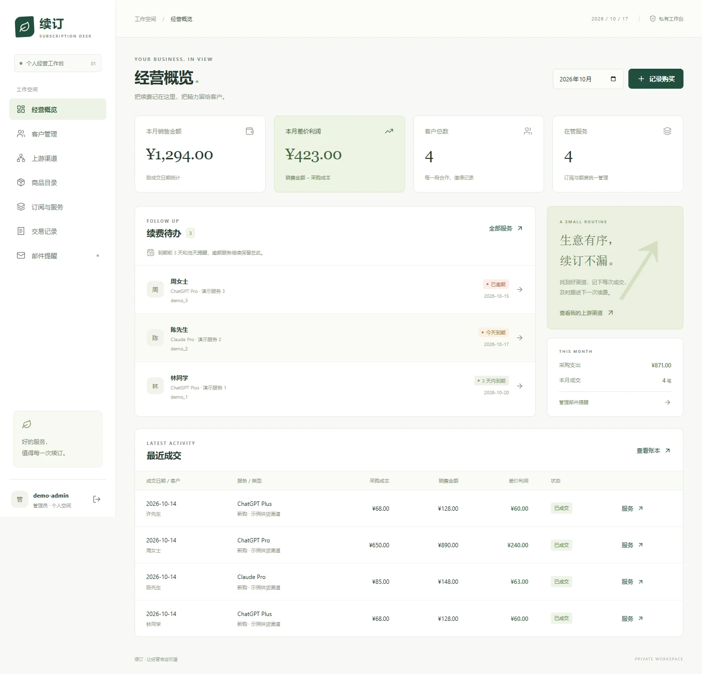
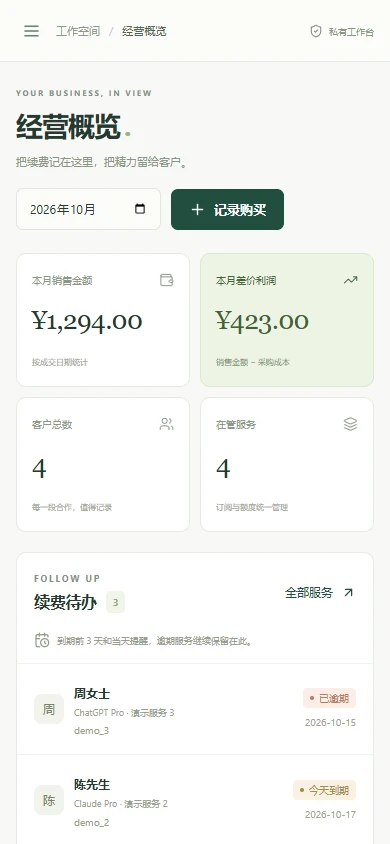

<p align="center">
  
</p>

<p align="center">
  <strong>为个人经营者管理 AI 服务订阅、客户与续费。</strong><br>
  录入渠道与商品，记录成交和利润，到期前 3 天及当天邮件提醒。
</p>

<p align="center">
  <a href="https://github.com/Celyn-number2/ai-subscription-manager/blob/main/frontend/package.json"></a>
  <a href="https://github.com/Celyn-number2/ai-subscription-manager/blob/main/backend/pyproject.toml"></a>
  <a href="https://github.com/Celyn-number2/ai-subscription-manager/blob/main/backend/app/db.py"></a>
  <a href="https://github.com/Celyn-number2/ai-subscription-manager/blob/main/backend/pyproject.toml"></a>
</p>

## 界面预览



<details>
<summary>手机端预览</summary>
<p align="center"></p>
</details>

截图使用独立演示数据。

## 能做什么

- **渠道与商品**：保存上游、交付方式、参考报价与质保条件。
- **客户与服务**：记录微信、QQ 等联系方式，一个客户管理多项订阅。
- **成交与利润**：保存每次购买、续费的实际成本与售价，自动计算人民币差价。
- **到期提醒**：支持日、周、月、年期限；邮件提醒经营者联系客户续费。

## 开始使用

需要 Python 3.12+、Node.js 22。两个终端分别启动后端和前端：

```sh
# 后端（Linux / macOS）
cd backend
python3 -m venv .venv
.venv/bin/python -m pip install -r requirements.lock
.venv/bin/python -m alembic upgrade head
.venv/bin/python -m uvicorn app.main:app --port 8000
```

```sh
# 前端
cd frontend
npm ci
npm run dev
```

访问 `http://localhost:5173`，首次设置唯一管理员账户。Windows 命令见[本地开发](docs/local-development.md)。

[部署与邮件配置](docs/deployment.md) · GitHub Actions + SSH 发布，无需 Docker。

邮件需配置 SMTP；无有效期的额度服务不触发到期提醒。差价利润不包含其他经营费用。
