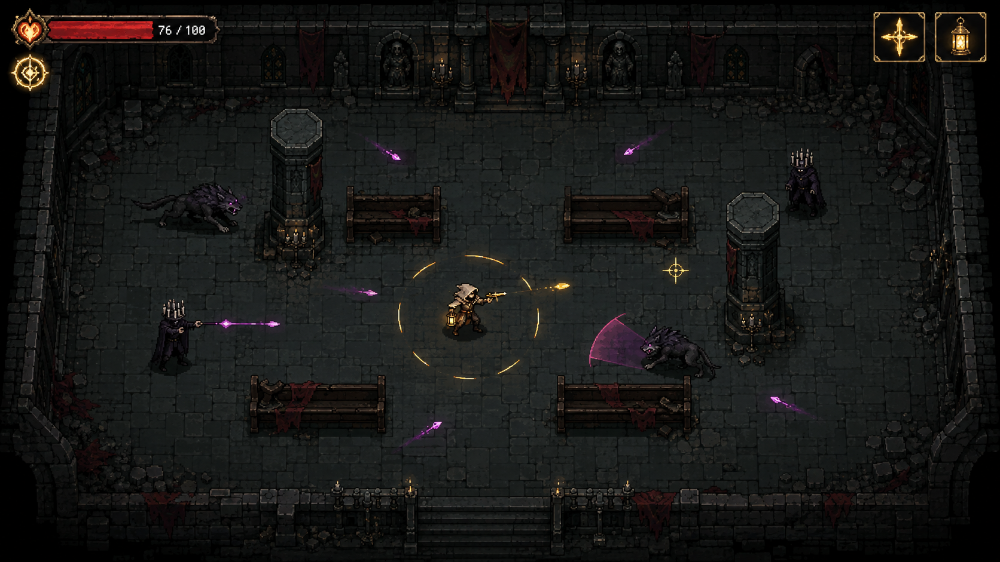

# Ember Covenant Sanctuary

《烬契圣堂》是一款高对比度 Pixel Art 风格的俯视角动作肉鸽。守烬人需要穿过七重熄灭圣堂，以自由瞄准射击和净焰脉冲对抗影兽，选择带有公开代价的双面契印，最终夺回最后火种。



## Play

使用任意静态文件服务器即可运行，例如 Python：

```sh
python3 -m http.server 8765
```

然后打开 <http://127.0.0.1:8765/>，按 `Ctrl+C` 停止服务器。

使用 VibeGame CLI 开发和调试时：

```sh
vibegame run --port 8765 --background --headless
vibegame close --port 8765
```

## Controls

| Action | Keyboard and mouse |
|---|---|
| Move | `WASD` or arrow keys |
| Aim and fire | Move the mouse and hold left click |
| Pureflame Pulse | `Q` or `K` |
| Interact | `E` or `Enter` |
| Choose a sigil | `1`, `2`, `3`, or click |
| Pause | `Esc` |

Touch controls are available on mobile layouts.

## Game Loop

- Clear seven room stages in an 8-12 minute run.
- Choose one of three double-sided sigils after combat.
- Pick the Recovery or Elite route midway through the sanctuary.
- Defeat the two-phase Fallen Bishop to recover the last flame.
- Death removes the current run's upgrades; restart from the result screen.

## Development

The game uses Phaser 3 and the VibeGame node/scene runtime. The repository includes the GDD, source code, runtime assets, and automated gameplay tests used during development.

```sh
vibegame check .
vibegame run . -b --headless --activate --port 8765
```
