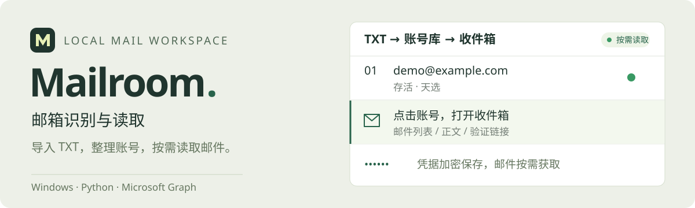
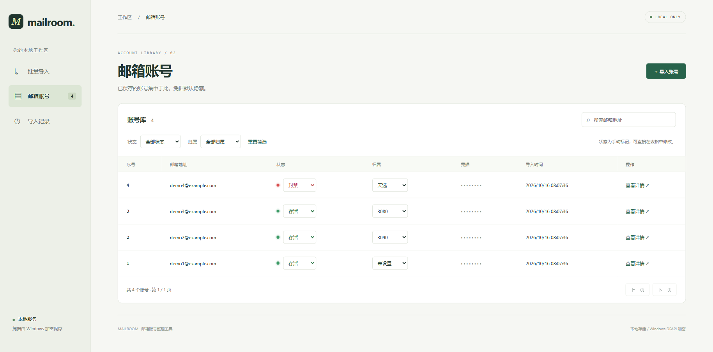
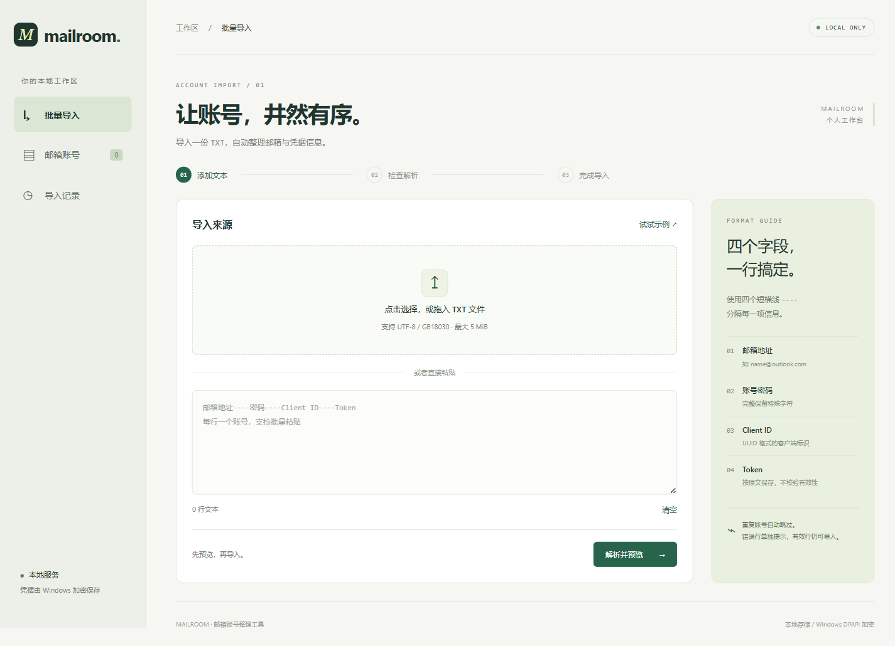
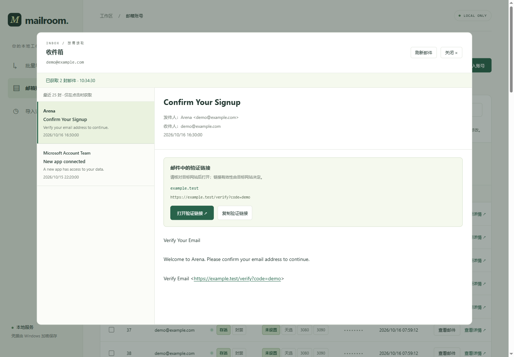

<p align="center">
  
</p>

<p align="center">
  <strong>一个轻量的 Windows 本地邮箱管理与读取工具。</strong><br>
  批量导入账号，整理状态与归属，复制邮箱地址，按需查看收件信息。
</p>

<p align="center">
  <a href="#启动"></a>
  <a href="#启动"></a>
  <a href="#功能"></a>
  <a href="#数据"></a>
</p>

## 功能

- **导入账号**：上传或粘贴 TXT，预览校验、去重，反馈错误行。
- **项目管理**：同一邮箱可加入多个项目，各项目独立保存状态与归属，支持项目筛选、单个或批量添加／移出；现有标记迁移到「Arena项目」。
- **整理账号**：点击邮箱地址复制；搜索、排序、状态与归属筛选，鼠标拖选后批量修改。
- **登录保护**：首次访问创建管理员账号，之后使用 HttpOnly 会话登录；密码以 PBKDF2 哈希保存。
- **查看邮件**：点击「查看邮件」读取最近 25 封收件箱邮件，自动显示第一封正文；支持打开或复制验证链接。无后台轮询。

## 界面截图

<p align="center">
  
</p>

<p align="center">
  
</p>

<p align="center">
  
</p>

## 启动

本地开发需要 **Windows、Python 3.10+ 和 Node.js 22.12+**；服务器运行构建产物只需要 Python 3.10+ 和 `requirements.txt` 中的依赖。

首次执行 `npm ci` 安装前端构建依赖，然后选择：

```powershell
# 开发：自动启动 Python 后端与 Vite，前端热重载
npm run dev
# 打开 http://127.0.0.1:48372
```

```powershell
# 日常使用：构建后由 Python 提供前端与 API
npm run build
python app.py --open
# 打开 http://127.0.0.1:48371
```

也可双击 `dev.bat` 开发，或双击 `start.bat` 构建并启动。CSS 修改即时更新，JS / HTML 修改自动刷新；Python 代码修改后重启开发服务。

## TXT 格式

每行一个账号，使用 `----` 分隔：

```text
邮箱地址----密码----Client ID----Refresh Token
```

导入后点击「查看邮件」。邮件读取需要有效的微软刷新令牌，以及对应应用已获得的 Graph 邮件读取权限；状态「存活 / 封禁」为手动标记。

## 登录与部署

首次启动后访问页面，会先创建管理员账号。密码不会写入代码或日志，只保存为哈希值。登录会话有效期为 7 天。

Windows 使用 DPAPI 加密邮箱凭据；Linux 服务器使用 `MAILBOX_ENCRYPTION_KEY` 提供的 Fernet 密钥。部署到公网前还需要配置 HTTPS、域名和防火墙；不要直接把原始 TXT 上传到代码仓库。

## 数据

凭据使用 Windows DPAPI 加密，数据库保存在 `data/`，不提交到 Git。解密依赖当前 Windows 用户；迁移到其他电脑前请保留自己的原始 TXT。服务仅监听本机，不提供公网多用户访问。

[详细使用说明](docs/usage.md)

## 测试

```powershell
python -m unittest discover -s tests -v
npm test
```

构建完成后，运行 `python app.py` 只需 Python，无第三方 Python 依赖。

默认端口：日常服务 `48371`、开发前端 `48372`、开发后端 `48373`。端口被占用时自动更换，以启动输出地址为准；开发代理自动跟随后端实际端口。环境变量指定的端口也支持自动避让。
