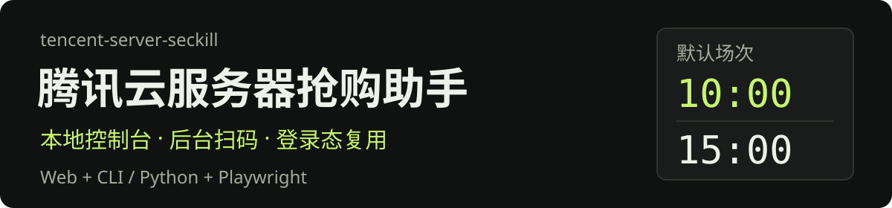
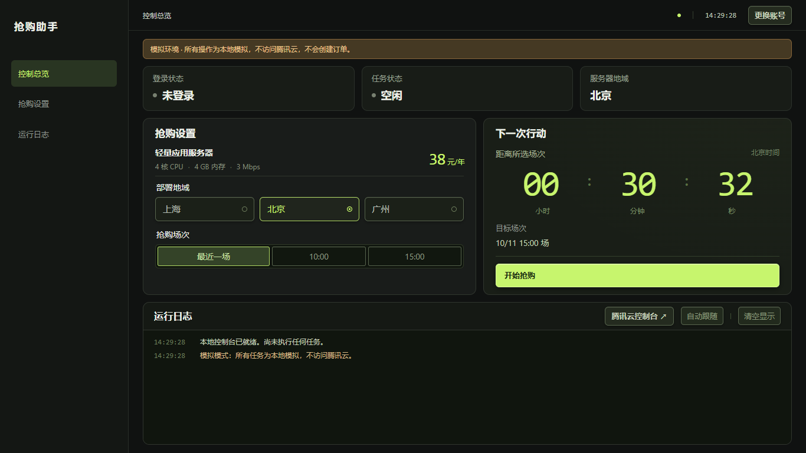
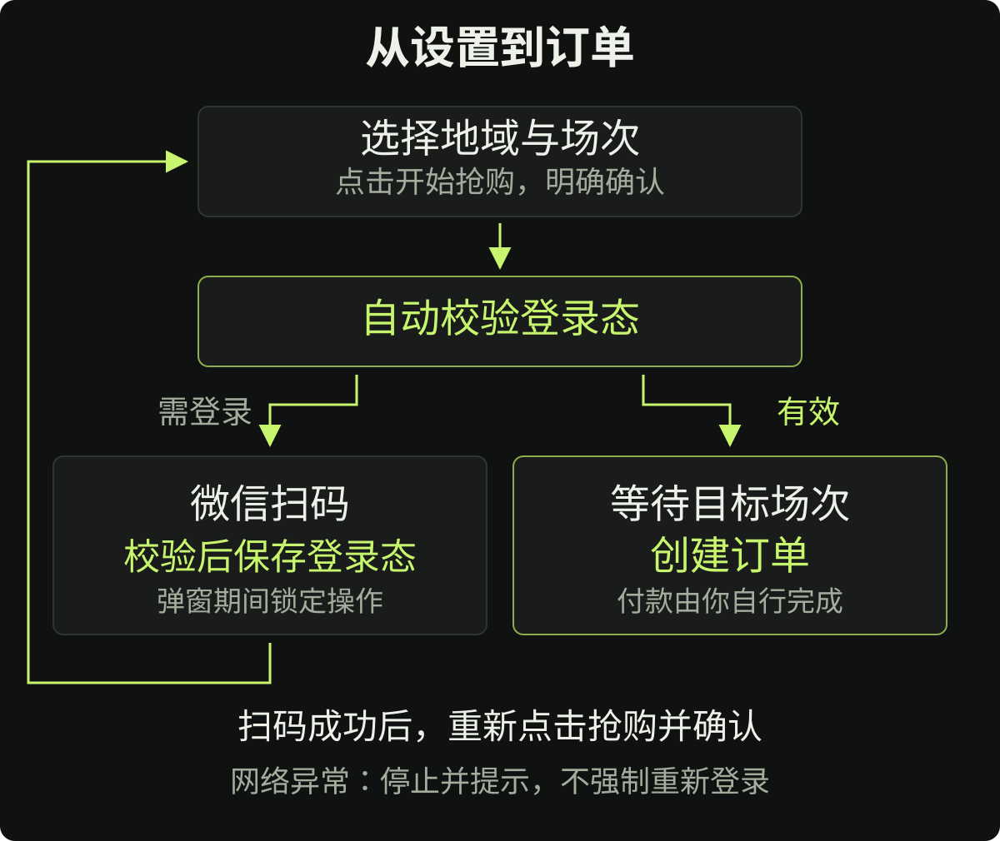

<p align="center">
  
</p>

<p align="center">
  <strong>把腾讯云服务器抢购脚本，变成可以直接操作的本地控制台。</strong><br>
  设置地域和场次，后台扫码复用登录态；明确确认后执行抢购，付款由你自行完成。
</p>

<p align="center">
  <a href="#安装与启动"></a>
  <a href="requirements.txt"></a>
  <a href="#使用方式"></a>
  <a href="#安全与隐私"></a>
  <a href="LICENSE"></a>
</p>

## 界面预览

[](assets/readme/dashboard.png)

*截图来自当前代码的独立模拟环境，没有使用真实账号或执行下单。点击图片可查看原始分辨率。*

> **使用前请了解**
>
> 本项目不是腾讯云官方产品。真实抢购会创建订单，自动化可能违反活动规则并导致账号受限。商品、价格、资格、库存及付款期限以腾讯云实际页面为准。程序不自动付款、不自动取消订单，也不保证抢购成功。

<p align="center">
  <a href="#安装与启动">安装启动</a> ·
  <a href="#日常使用">日常使用</a> ·
  <a href="#登录与-cookie">登录与 Cookie</a> ·
  <a href="#使用方式">命令行</a> ·
  <a href="#常见问题">故障排查</a> ·
  <a href="#开发与验证">开发验证</a>
</p>

## 功能一览

| 功能 | 当前行为 |
| --- | --- |
| 本地 Web 控制台 | 中文界面，地域与场次选择、倒计时、状态和日志集中在一屏；小屏幕使用响应式布局 |
| 后台微信扫码 | 无头浏览器直接打开登录页，二维码显示在控制台弹窗中，不用再手动点击浏览器里的登录按钮 |
| 登录态复用 | 保存 Cookie 与浏览器存储状态，下次任务自动加载；只有未登录或明确过期才引导扫码 |
| 登录期间锁定 | 弹窗出现后禁止取消、刷新、Esc、遮罩关闭及后台操作；成功自动关闭，失败或超时解锁并提示 |
| 单任务运行 | 同一服务同时只运行一个任务，避免重复点击启动多个购买任务 |
| 自动对时 | 在浏览器中查询服务器时间，等待期间接近开抢时再次校准 |
| 状态与日志 | 展示等待、登录检测、请求结果和错误位置；刷新页面可恢复当前服务的任务状态与日志 |
| 原命令行保留 | 交互菜单和底层脚本继续可用；真实测试下单入口不放在 Web 页面上 |

技术栈很小：**Python 标准库 HTTP 服务 + Playwright + 原生 HTML / CSS / JavaScript**。使用 Web 控制台不需要安装 Node.js，也没有前端构建步骤。

## 安装与启动

### 环境要求

- Python **3.10 或更高版本**。
- 本机 Chrome、Edge，或 Playwright 安装的 Chromium。
- 正常使用时需要访问腾讯云和微信登录服务；微信扫码使用你的手机完成。
- 场次按北京时间使用，请把运行机器的时区设为 **UTC+8**。

Windows 是主要使用和验证环境。源码包含 macOS / Linux 浏览器启动路径，可用 Python 命令启动；这两个平台没有完成与 Windows 同等范围的实机验证。

### 获取项目

下载仓库 ZIP，或克隆后进入项目目录：

```bash
git clone https://github.com/HP-Patience/tencent-server-seckill.git
cd tencent-server-seckill
```

私有仓库需要相应的 GitHub 访问权限。

### 推荐：独立 Python 环境

在项目根目录执行：

```powershell
python -m venv venv
.\venv\Scripts\python.exe -m pip install -r requirements.txt
.\venv\Scripts\python.exe seckill_web.py --open
```

这种写法不需要激活虚拟环境，也不需要修改 PowerShell 执行策略。

已经配置好 Python 环境时，可以直接运行：

```bash
python -m pip install -r requirements.txt
python seckill_web.py --open
```

安装 `requirements.txt` **不会自动下载浏览器**。程序按 Chrome → Edge → Playwright Chromium 的顺序尝试启动；本机浏览器都无法使用时，在同一个 Python 环境执行：

```bash
python -m playwright install chromium
```

使用虚拟环境时，把上面的 `python` 换成 `venv` 中的 Python，例如：

```powershell
.\venv\Scripts\python.exe -m playwright install chromium
```

<details>
<summary>macOS / Linux 的命令形式</summary>

```bash
python3 -m venv venv
./venv/bin/python -m pip install -r requirements.txt
./venv/bin/python -m playwright install chromium
./venv/bin/python seckill_web.py --open
```

Linux 可能还需要浏览器系统依赖，请参考 [Playwright 官方安装文档](https://playwright.dev/python/docs/intro)。强制停止时的进程清理也存在平台差异，见下方停止任务说明。

</details>

### Windows 一键启动

依赖安装完成后，双击：

**`腾讯云服务器抢购Web控制台.bat`**

启动脚本优先使用 `venv` / `.venv` 中的 Python，再尝试 PATH 中的 `python` 或 `py -3`，随后启动服务并打开浏览器。

默认地址：**`http://127.0.0.1:8765`**。

如果端口被占用或被 Windows 保留，换一个端口：

```bash
python seckill_web.py --port 18976 --open
```

此时访问 `http://127.0.0.1:18976`。**以启动窗口打印的地址为准**，不要把其他应用占用的端口当成本项目页面。

服务启动本身不会扫码、校验真实账号或下单。请保持启动窗口运行；按 `Ctrl+C` 关闭服务。

## 日常使用

通常只需要：**选择地域与场次 → 开始抢购 → 阅读风险提示并确认**。

### 选择地域与场次

地域可选上海、北京、广州，修改后自动保存。默认地域为北京。

场次可选“最近一场”、`10:00`、`15:00`。在 **Web 模式**下，已经结束的指定场次会顺延到次日；页面显示具体目标日期和时间，而不是只显示一个时刻。

倒计时用于展示状态，真正的等待和开抢由后端 Python 执行。关闭或刷新网页不会改变已经运行的后端任务。

### 首次登录或更换账号

- 没有登录态或后端明确判断已过期时，页面会引导登录。
- 主动更换账号，点击右上角 **“更换账号”**，确认后在本页显示二维码。
- 用微信扫码，在手机上完成授权。后台识别扫码状态并自动校验登录。
- 校验通过后保存登录态，关闭二维码弹窗和后台浏览器；**不会自动开始抢购**，仍需你重新点击并确认。

二维码下方会显示高亮提示：

> **扫码后登录会自动校验，请等待二维码消失再操作**

二维码弹窗出现后，弹窗及背后的控制台会锁定。此时不能取消、刷新二维码、按 Esc、点击遮罩关闭或操作其他按钮。

成功后自动解锁；失败、手机端拒绝授权或扫码等待超过 **10 分钟**时，解锁并显示错误。连接本地服务失败时，也会退出锁定并提示无法确认结果；恢复连接后，以后端的实际状态为准。

锁定仅作用于控制台内部，不能阻止你强制关闭浏览器标签页、窗口或结束系统进程。

### 查看结果与付款

任务结果和订单信息显示在日志中。点击日志栏右侧的 **“腾讯云控制台”**，自行核实订单、付款或取消。

控制台链接打开的是正常浏览器页面，它与后台抢购浏览器的登录态隔离。因此，付款页面可能需要正常登录对应腾讯云账号；这不代表后台保存的 Cookie 丢失。

**实际支付截止时间以订单页面为准。** 不要仅凭日志中的“成功”推断已经付款，也不要仅凭“失败”或“已停止”断定没有生成订单。

### 停止与退出

抢购任务运行中，可以点击 **“停止当前任务”**。程序先请求任务清理；约 8 秒仍未退出时，Windows 下会终止本次任务的进程树，不结束你日常使用的其他浏览器。

- **停止任务不会撤销已经提交的订单。** 已经发出的并发请求也可能到达服务器，请到腾讯云控制台核实。
- 关闭网页不会停止后端抢购任务；关闭服务才会清理当前任务。
- 登录弹窗锁定期间不能通过页面停止登录，成功、失败或超时后会退出锁定。
- 单任务限制只覆盖当前服务实例，不是跨进程、跨设备的全局锁。不要同时启动多个 Web 服务或并行运行旧 CLI。
- 非 Windows 平台的超时强制终止分支只终止任务进程，没有实现同等的进程树清理，请留意残留的浏览器子进程。

## 登录与 Cookie

登录状态保存在项目根目录的 **`.state.json`**，使用 Playwright 的浏览器存储状态格式，包含 Cookie 和相关 localStorage 状态。

每次任务会新建隔离浏览器上下文，再载入这个文件。**新开浏览器不等于重新登录**，也不会直接使用或修改你日常浏览器的个人配置文件。

| 页面状态 | 含义 |
| --- | --- |
| 未登录 | 没有保存的登录态 |
| 已保存 · 待校验 | 有本地文件，但当前服务还没有在线验证；重启服务后出现此状态是正常现象 |
| 已登录 | 本次运行已通过真实的只读登录查询 |
| 登录已失效 | 返回了明确的未登录或过期状态，需要扫码 |
| 验证未通过 | 网络、页面、CSRF 或接口异常，暂不能确认；不直接等同于 Cookie 过期 |

新账号的状态会先在独立上下文中复验，成功后才原子替换本地文件。失败、超时或中断不会把未验证的新账号覆盖到原登录态上。

当前实现会捕获真实请求中的 CSRF Token，使用共享 Cookie 的只读查询确认登录，不再为复验完整加载一遍活动页。前端在登录期间更及时地读取状态；动画仅反馈扫码与验证阶段，不人为延长等待。

**`.state.json` 是明文登录凭据，不是加密保险箱。** 不要上传到 Git、发给别人、放入截图或公开备份。它已经加入 `.gitignore`，但忽略规则不能撤回曾经提交过的敏感文件。

## 使用方式

### Web 启动参数

| 参数 | 作用 |
| --- | --- |
| `--open` | 启动成功后自动打开浏览器页面 |
| `--port 18976` | 指定本地端口；默认 `8765` |
| `--demo` | 使用纯本地模拟任务，不访问腾讯云或创建订单 |
| `--help` | 查看帮助，不启动服务 |

### 无下单演练

```bash
python seckill_web.py --demo --port 18976 --open
```

页面会明确显示模拟提示。模拟任务不加载真实腾讯云浏览器流程，不扫码、不创建订单，也不覆盖项目登录态。

模拟二维码只是界面占位，**不能扫码**。模拟通过只证明控制台交互和任务管理可运行，不证明当前活动、库存、资格或接口仍然可用。

### 交互式命令行

```bash
python seckill_ui.py
```

| 选项 | 作用 |
| --- | --- |
| `1` | 选择地域 |
| `2` | 打开可见浏览器，手动扫码登录并保存状态 |
| `3` | 等待最近一场并执行真实抢购 |
| `4` | 选择 `10:00` 或 `15:00` 场次 |
| `5` | 只读连通测试，不下单 |
| `6` | **真实测试下单，会创建订单** |
| `0` | 退出菜单 |

原版 `腾讯云服务器抢购助手.bat` 仍保留。推荐使用上面的 Python 命令或新 Web 启动脚本，尤其是在本机 Python 路径与原版启动脚本预设不一致时。

### 直接调用核心脚本

```bash
# 真实抢购：仅在了解脚本行为和活动风险后执行
python seckill.py --time 15:00

# 查看参数，不启动浏览器或下单
python seckill.py --help
```

<details>
<summary>危险调试入口与旧 CLI 的行为边界</summary>

```bash
# 危险：会真实创建订单，不是无副作用的连通测试
python seckill.py --test
```

- Web 页面已经移除“真实测试下单”按钮；底层 CLI 与兼容任务类型仍保留，勿误调用。
- 直接执行 `seckill.py` 使用源码中的商品与默认地域，不会自动套用 Web 的地域选择。需要地域菜单时使用 `seckill_ui.py`。
- 原 CLI 的指定场次按当天计算，过去的时刻不会像 Web 模式那样自动顺延，请自行检查日期和时间。
- `--loop` 参数目前虽然存在，但尚未实现持续多场调度，不应把它当成自动循环功能。
- 原 CLI 的预热函数会调用购买接口；Web 模式已改为无订单副作用的登录查询预热。
- Web 模式的二维码弹窗锁定、明确区分网络异常与登录过期等改进，不应理解为旧 CLI 已全部同步获得。

</details>

## 工作原理

<p align="center">
  
</p>

### 一条真实抢购任务如何执行

1. 前端提交地域、场次和明确的购买确认，服务端检查参数与本机安全令牌。
2. 服务启动一个 Python 子进程，载入保存的登录态，使用 Playwright 控制隔离浏览器。
3. 验证登录并等待真实 CSRF Token；未登录、过期或无法确认时不继续购买。
4. 查询服务器时间，选定目标场次，在接近开抢时重新对时。
5. 开抢前通过只读登录查询复验、预热；然后在浏览器页面上下文中调用购买接口。
6. 将明确结果返回控制台，清理后台浏览器。没有明确成功结果时，不把正常退出当成下单成功。

Cookie 和认证信息由浏览器上下文处理，不是从前端页面复制到 Python 中，也不依赖 DOM 上反复点击“立即抢购”。

### 当前源码中的默认配置

| 配置 | 默认值 |
| --- | --- |
| 活动路径 | `https://cloud.tencent.com/act/pro/featured-202607` |
| 页面参考商品 | 轻量应用服务器，4 核 / 4 GB / 3 Mbps，38 元 / 年 |
| 地域 ID | 上海 `4`、北京 `8`、广州 `1` |
| 场次 | `10:00`、`15:00` |
| 提前量 | 约提前 3 秒开始请求 |
| 购买窗口 | 默认持续约 10 秒，确认成功后提前结束 |
| 并发数量 | 每批 10 个请求 |
| 批次间隔 | 配置为 20ms；网络请求本身的耗时另计 |

这些是**代码配置，不是实时活动信息**。商品 ID、活动 ID、规格、价格及场次可能随活动改变，页面显示不会自动同步官网商品目录。维护商品时，需同时检查 `seckill.py` 的活动 / 商品配置以及 `web/index.html`、`web/app.js` 的规格、价格和确认文案，避免界面与请求商品不一致。实际成交规格和价格请在控制台核实，不要盲目提高并发或请求频率。

时间校准基于 HTTP `Date` 响应头的多次采样及中位数，不是 NTP，也不保证毫秒级精度；本机时区与网络延迟仍会影响结果。

## 配置与文件

### 地域配置

首次保存地域时生成 `config.json`，例如：

```json
{
  "region": 8
}
```

Web 保存地域时保留已有配置中的其他键。文件损坏时会报错，不会用默认配置静默覆盖；不要手动填写界面不支持的地域 ID。

### 项目结构

```text
tencent-server-seckill/
├── README.md
├── LICENSE
├── requirements.txt
├── 腾讯云服务器抢购Web控制台.bat  # 推荐的一键 Web 入口
├── 腾讯云服务器抢购助手.bat       # 原版命令行入口
├── seckill_web.py                 # 本地 HTTP 服务、校验与任务管理
├── web_worker.py                  # 非交互任务、二维码、登录校验
├── seckill.py                     # 浏览器启动、对时与购买核心
├── seckill_ui.py                  # 原版交互菜单
├── web/                          # HTML、CSS、JavaScript 和 favicon
├── tests/                        # 单元测试与模拟浏览器回归
├── assets/readme/                # 本 README 的静态 SVG 与界面截图
├── docs/superpowers/              # 设计和实施记录
├── .state.json                   # 运行生成：登录态，不提交
├── config.json                   # 运行生成：地域配置，不提交
└── *.log                         # 运行日志，不提交
```

`.state.json.tmp`、`config.json.tmp` 是原子保存时的临时文件。`.gitignore` 同时忽略这些文件、`venv/`、`.venv/`、Python 缓存和本地工具记录。

Web 日志缓存最多保存最近 **1,000 条**，存在服务内存中。清空显示不会删除缓存，刷新网页可恢复；重启服务会重置当前任务记录和内存日志。

核心可能写入 `seckill.log`，旧菜单写入 `seckill_ui.log`。如果有 `seckill_web_session.log`，它是手动备份的会话记录，不是 Web 服务自带的持久化数据库。不要公开含订单、账号或请求信息的日志。

## 安全与隐私

- 服务绑定 `127.0.0.1`，不是面向公网的多用户系统。不要直接公开端口或在不理解风险时添加公网代理。
- 变更接口检查本地 Host、Origin、随机服务令牌以及 JSON 参数，不启用跨域访问。
- 静态资源使用固定白名单，不提供读取项目源代码、完整配置或 `.state.json` 的文件接口。
- Cookie 和 CSRF 不通过状态接口返回给前端。二维码只保留在本次登录任务的内存中，结束后清除，不写入项目文件或日志。
- 错误日志使用安全分类与代码位置，避免直接输出可能包含认证头的异常全文；这不代表所有业务日志都适合公开分享。
- Web 登录验证只调用无订单副作用的查询。确认身份失败时停止购买，不按“可能有效”继续下单；旧 CLI 的行为边界单独说明。
- 同一服务的单任务限制无法撤回已提交请求，也不能保证一批并发请求最终只形成一张订单。
- 程序不会绕过验证码、账号资格、库存限制或付款步骤。登录仍需你在微信中主动授权。

<details>
<summary>本地接口概览（开发用）</summary>

| 接口 | 作用 |
| --- | --- |
| `GET /api/status` | 任务、登录、地域及服务器时间；登录进行中可能包含本次二维码图片 |
| `GET /api/logs?after=<seq>` | 有界增量日志，包含缓存截断标记 |
| `POST /api/config` | 保存合法地域 |
| `POST /api/tasks` | 创建经过校验的任务；购买类任务必须有明确确认 |
| `POST /api/tasks/stop` | 按当前任务 ID 请求停止 |
| `POST /api/tasks/refresh-qr` | 兼容的后台二维码刷新接口；当前锁定式 UI 不允许手动刷新 |

变更请求需要同源 Origin、`X-Console-Token`、JSON 内容类型以及正确的任务参数。令牌绑定当前服务进程，服务重启后旧页面的令牌会失效，请刷新页面。不要把本地 API 当成公网认证接口，也不要把令牌贴到 Issue 中。

</details>

## 常见问题

<details>
<summary>为什么重启后显示“已保存 · 待校验”，而不是“已登录”？</summary>

本地文件存在不等于 Cookie 还有效。启动页面不会自动联网校验账号，开始抢购时才验证；通过后显示“已登录”。不用每次重新扫码。

</details>

<details>
<summary>二维码一直没有消失，页面又不能操作？</summary>

扫码后还要在手机微信中确认授权，随后程序验证身份并保存状态。验证完成前页面保持锁定，不应提前操作。失败、拒绝授权或超过等待期限会解除锁定并显示错误。

查看弹窗状态与日志中的阶段。如果页面提示本地服务连接中断，先确认启动窗口仍在运行，再刷新页面。锁定不能替代浏览器或操作系统的进程管理能力。

</details>

<details>
<summary>提示“没有可用的浏览器”或浏览器程序不存在？</summary>

确认运行环境中安装了 Playwright，并且本机 Chrome / Edge 可用。都无法启动时，用启动服务的同一个 Python 安装 Chromium：

```bash
python -m playwright install chromium
```

不要在另一个 Python 环境安装依赖后，用不同解释器启动服务。

</details>

<details>
<summary>端口 8765 被占用、出现 WinError 10013，或打开了别的应用？</summary>

换一个可用端口，并访问服务实际输出的地址：

```bash
python seckill_web.py --port 18976 --open
```

不必关闭其他本地应用，也不必把服务暴露到公网。

</details>

<details>
<summary>网络错误、CSRF 未捕获或登录“验证未通过”？</summary>

这不必然意味着 Cookie 过期。网络、页面脚本和接口变化都可能导致校验失败；程序会阻止购买，不会立即强制重新扫码。

检查日志中的发生阶段、网络错误类型和代码位置。恢复网络后可重新尝试；如果活动页或微信二维码结构改变，需要维护对应解析逻辑，而不是反复点击抢购。

</details>

<details>
<summary>服务重启后操作提示安全校验失败？</summary>

页面还持有上一次服务的令牌。刷新页面，再重新操作；不要删除 Cookie 文件来解决服务令牌问题。

</details>

<details>
<summary>停止、超时或报错后，怎么确认有没有订单？</summary>

前往 [腾讯云控制台](https://console.cloud.tencent.com/) 核实。已发出的请求可能已经被服务器接受，停止不能撤回；尤其是购买阶段的网络异常，不能只看本地状态下结论。付款与取消由你自行处理。

</details>

<details>
<summary>活动、价格和场次会自动更新吗？</summary>

不会。当前脚本绑定具体活动配置，页面价格也不是实时抓取结果。使用前对照 [活动页面](https://cloud.tencent.com/act/pro/featured-202607) 检查资格、商品和规则；活动换期后可能需要更新源码配置。

</details>

## 开发与验证

所有默认自动测试使用 Mock、临时目录或明确的 `--demo` 任务，不调用购买接口，不覆盖项目 Cookie 或配置。

```bash
# 后端与任务逻辑测试
python -m unittest discover -s tests -v

# 模拟浏览器回归；本机需安装 Chrome
python tests/browser_check.py

# Python 语法检查
python -m compileall -q seckill_web.py web_worker.py tests
```

可选的前端语法检查需要 Node，但**仅使用产品不需要 Node**：

```bash
node --check web/app.js
```

测试覆盖参数和购买确认校验、服务安全边界、配置保存、任务并发与停止、二维码状态、登录态复验、超时解锁、Esc / 遮罩锁定、断线恢复、日志转义和桌面一屏布局。

浏览器回归使用临时本地服务和模拟登录，不会替你扫码。模拟二维码仅用作占位。通过测试不代表真实活动接口、账号资格或库存一定可用，真实扫码与支付结果仍需自行核实。

### 提交前检查

- 更新功能时，同步对应测试和 README，保持默认启动不产生订单。
- 不要提交 `.state.json`、`config.json`、临时文件、运行日志或虚拟环境。
- 分享问题时提供脱敏的阶段日志、运行命令、Python / 浏览器版本，不提供 Cookie、CSRF、扫码二维码或订单详情。
- 修改 CLI 和 Web 公用核心时，检查两个入口的行为差异，避免把调试购买命令当成连通测试。
- README 素材保存在 `assets/readme/`；保留 SVG 源文件，更新界面后使用无真实账号的模拟截图。

## 免责声明与许可证

本项目仅供个人学习与研究。使用者应遵守腾讯云及微信的服务规则，不进行高频滥用、资格绕过或影响其他用户的操作。账号限流、功能受限、活动变更、接口失效和订单处理风险由使用者自行承担。

本项目不提供抢购成功承诺，不代替官方客服，也不会自动管理付款或退款。

原始脚本来源：[djs-91/tencent-server-seckill](https://github.com/djs-91/tencent-server-seckill)。本项目保留原始提交历史与作者版权声明，增加本地 Web 控制台及对应测试、文档。

采用 [MIT License](LICENSE)。原始版权声明保留在许可证文件中。
